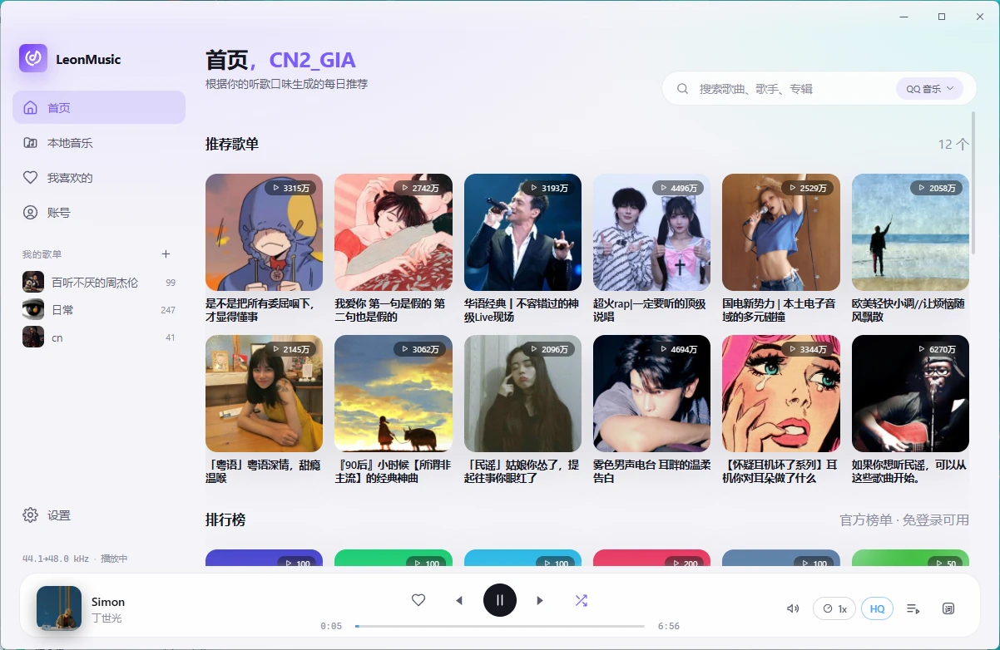
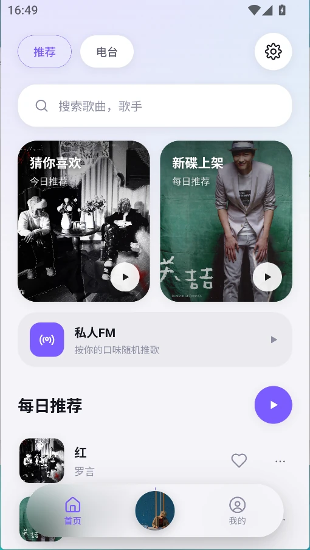
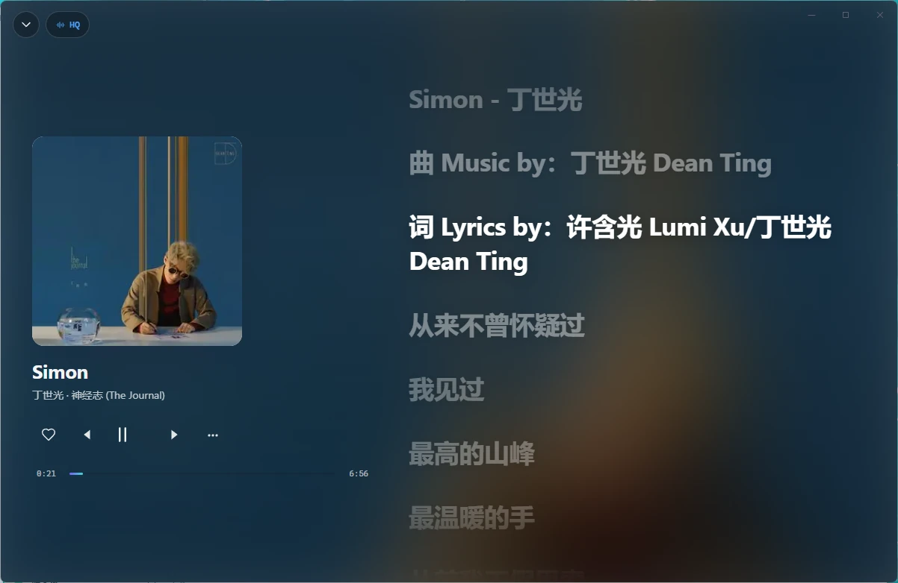
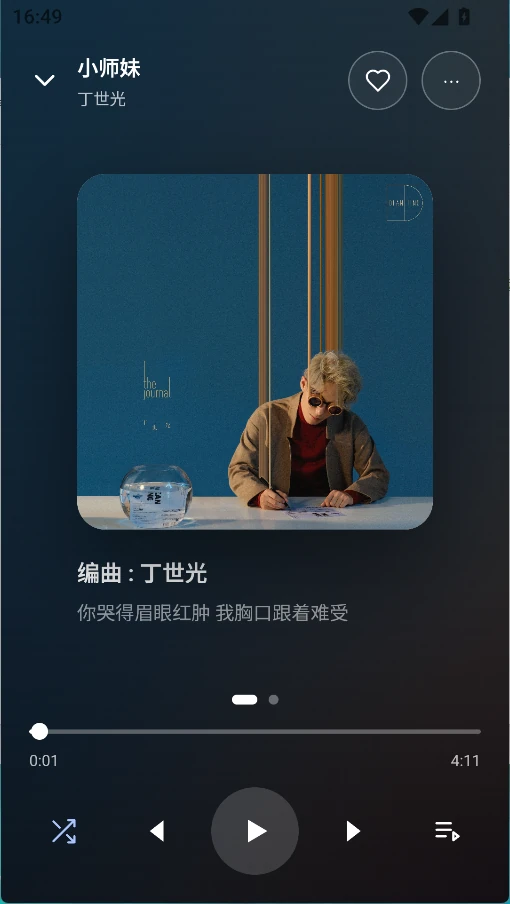
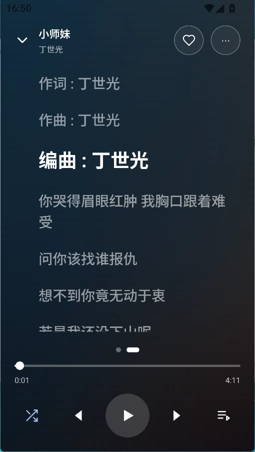
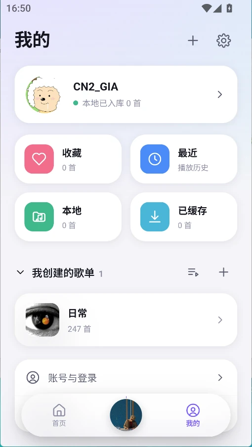

<div align="center">


# LeonMusic

**把音频内核完全装进 Rust 的轻量音乐播放器 · Windows / Android**

[下载体验](https://github.com/ChenL-eon/LeonMusic/releases) · [问题反馈](https://github.com/ChenL-eon/LeonMusic/issues) · [查看截图](#-页面展示) · [开发文档](docs/DEVELOPMENT.md)

*Tauri v2 + Rust 音频引擎 + Vue 3 —— 不是浏览器套壳，解码、重采样、变速变调、歌词解析全部原生运行。*

</div>

---

## 📖 简介

LeonMusic 是一个「前端只做遥控器」的音乐播放器：WebView 被销毁也不影响播放，
进度由设备真实消费的帧数推导、永不漂移，整条播放链路（解码 → WSOLA 变速变调 →
重采样 → 声卡）都在 Rust 进程里跑。

在线能力通过**音源插件**提供：内置网易云插件开箱即用（支持扫码 / 验证码 / Cookie 登录、
受限歌曲解析、听歌打卡），也支持 Navidrome / Jellyfin / Emby 自建媒体库，
还可以自己写一个插件接任何音源。

## 🚀 快速开始

- 下载地址：[Releases](https://github.com/ChenL-eon/LeonMusic/releases)
- 问题反馈：[Issues](https://github.com/ChenL-eon/LeonMusic/issues)
- Windows：解压便携包直接运行，无需安装（只依赖系统自带的 WebView2）
- Android：安装 APK，建议给予「忽略电池优化」以保证后台播放
- 应用内「设置 → 更新与关于 → 检测更新」可检查新版本

## ✨ 为什么值得用

- **更轻更干净**：没有 Electron，没有内置广告与内容推荐位，安装包只有十几 MB
- **播放引擎原生**：48 kHz 统一输出，变速不变调、变调不变速，切歌无接缝
- **双在线音源**：网易云 + QQ 音乐两个搜索源，网易云没版权的曲目（周杰伦、部分日韩与欧美专辑）可在 QQ 音乐里搜到并播放
- **在线生态完整**：网易云登录、每日推荐、歌单导入、云端歌单同步、听歌打卡
- **受限歌曲解析**：官方只给试听时按「酷我 BD → 咪咕 → GD 音乐台」自动取全曲；拿到 128k/320k 这类低规格不会收工，会继续换源直到取到档位要求的音质，全失败才回落试听，可一键关闭
- **桌面歌词好用**：卡拉 OK 逐字高亮、鼠标穿透锁定、字号颜色排版可调，锁定后在播放条一键解锁
- **本地库也强**：扫描本地音乐、自动匹配封面歌词、本地歌单、整曲缓存离线重播
- **真·跨端一致**：Windows 与 Android 共享同一份 Rust 内核与同一套 Vue 界面

## 🖼 页面展示

桌面端与移动端共用同一套 Vue 界面与 Rust 音频内核。下面按功能**两端对齐**展示：
同一行左侧为 Windows、右侧为 Android，图片统一显示高度，方便直接对照两种形态的布局。

### 首页 · 推荐与曲库

桌面端把侧边曲库、推荐歌单与排行榜平铺在一屏；移动端收成卡片流 + 底部导航。

<table width="100%">
  <tr>
    <th align="center" width="65%">桌面端 · Windows</th>
    <th align="center" width="35%">移动端 · Android</th>
  </tr>
  <tr>
    <td align="center"></td>
    <td align="center"></td>
  </tr>
</table>

### 正在播放 · 沉浸歌词

桌面端是「封面与控制在左、逐字歌词在右」的横向沉浸页；移动端改为竖版封面页，
上滑即可切到全屏歌词页。

<table width="100%">
  <tr>
    <th align="center" width="65%">桌面端 · Windows</th>
    <th align="center" width="35%">移动端 · Android</th>
  </tr>
  <tr>
    <td align="center"></td>
    <td align="center"></td>
  </tr>
</table>

### 更多移动端界面

<table width="100%">
  <tr>
    <th align="center">全屏歌词页</th>
    <th align="center">「我的」</th>
  </tr>
  <tr>
    <td align="center"></td>
    <td align="center"></td>
  </tr>
</table>

> 桌面歌词悬浮窗（卡拉 OK 逐字高亮 / 置顶 / 锁定穿透）、安卓通知栏与锁屏媒体卡片
> 的功能说明见下方「核心功能」。

## 📦 下载与平台支持

请前往 [Releases](https://github.com/ChenL-eon/LeonMusic/releases) 下载最新版本。

| 平台 | 文件 | 说明 |
|---|---|---|
| Windows x64 | `LeonMusic-…-windows-x64-setup.exe` | 安装包，双击安装 |
| Windows x64 | `LeonMusic-…-windows-x64-portable.zip` | 便携版，解压即用 |
| Android arm64 | `LeonMusic-…-android-arm64.apk` | 直装 APK（Android 8.0+） |

### 检测更新

应用内置「设置 → 更新与关于 → 检测更新」，对照本仓库的 GitHub Releases
检查新版本；发现新版本时会展示更新说明并提供下载入口。手动更新：下载新包
覆盖旧程序目录即可，配置与歌单数据保存在用户数据目录，升级不会丢失。

## 🎯 核心功能

### 在线内容

- 桌面首页搜索框右侧、独立搜索页与移动端搜索页可切换「网易云音乐」与「QQ 音乐」两个音源，QQ 音源匿名可用、无需登录；三个入口共用同一份当前音源
- 「设置 → 音源插件 → 记住搜索平台」默认开启：重启后沿用上次选的音源，关闭则每次启动回到网易云音乐
- 网易云账号登录：扫码 / 手机验证码 / Cookie 三种方式，凭据只存本机
- 每日推荐、推荐歌单、歌单详情、搜索
- 云端歌单导入本地（含封面）、「我喜欢的音乐」同步
- 听歌打卡：满 30 秒自动上报，计入最近播放与听歌排行
- 歌单链接导入：网易云（完整链接 / `163cn.tv` 短链）与 QQ 音乐（网页链 / 分享页 / 短链），只导入到本地歌单，不同步到任何账号；QQ 歌单每首曲目带专辑封面，旧版本已导入的歌单启动后会自动补全封面（账号页也可手动补全）

### 本地音乐库

- 导入本地音乐文件夹，中文文件名、音轨号正确处理
- 封面与歌词（逐字 LRC）自动匹配，本地歌单可自定义封面
- 未登录也能完整使用本地播放

### 桌面体验

- 桌面歌词悬浮窗：逐字卡拉 OK 渐变、置顶、锁定穿透、横竖排版、字号颜色可调
- 系统托盘、SMTC 系统媒体控制（锁屏 / 媒体键）
- 无框窗口：标题栏与主界面融合，右上角自绘窗口控制按钮
- 深浅色主题 + 自定义主色，播放页沉浸背景

### 安卓端体验

- 设置改为分组卡片首页（播放与声音 / 界面与歌词 / 音源与服务 / 关于），支持搜索设置；桌面端设置页保持原样
- 通知栏播放控制：封面、歌名、歌手、上一首 / 暂停 / 下一首，进度由 MediaSession 同步给系统
- 锁屏媒体卡片：封面、进度拖动、切歌与暂停；蓝牙耳机与有线线控按键也能控制
- 「设置 → 通知与锁屏」可查看通知权限 / 媒体会话 / 前台服务状态、分别开关两项控制、跳系统通知设置
- 播放由 Rust 音频引擎驱动，前台服务只负责把进程钉住并展示控制，WebView 被回收不影响续播

### 播放控制与音质

- 播放队列管理：下一首播放、拖动排序、随机 / 列表 / 单曲循环
- 变速（0.5–3.0×）与变调（±12 半音）独立控制，WSOLA 算法无 C 依赖
- 六档在线音质（标准 → 无损），真实码率与来源回显（LQ / SQ / HQ / FLAC / Hi-Res 彩色徽标）
- 解析播放源可手动开关、自定义尝试顺序
- 整曲缓存：播过一次即可离线重播

### 音源插件

- 插件协议 API v1：`manifest.json + index.js`，改完即生效
- 宿主注入 `leon.http` / `leon.crypto`（AES/RSA/摘要）等能力，JS 沙箱有指令数与递归深度上限
- 内置：网易云（登录 / 解析 / 打卡）、Navidrome、Jellyfin、Emby
- 自建服务（Navidrome / Jellyfin / Emby）收在设置页「流媒体」独立页签，默认关闭并收起配置，开启后才展开
- 插件开发说明见[开发文档](docs/DEVELOPMENT.md)

## ❓ 常见问题

**1. 为什么在线 VIP 歌曲只播 30 秒？**

试听权益由账号是否会员决定，客户端无法解除。登录会员账号可播权限内完整曲目；
未登录或无会员时默认走「受限歌曲解析」由第三方解析源取全曲（可在设置里关闭）。

**2. 扫码登录提示「设备环境异常」？**

这是网易云对第三方客户端的账号级风控。改用**手机验证码登录**或 **Cookie 登录**（真实浏览器登录后复制 `MUSIC_U` 凭据）即可，两者不依赖扫码链路。

**3. 桌面歌词锁定了怎么解锁？**

锁定后歌词窗鼠标穿透，此时播放条右侧的「词」按钮会变成锁形，点一下即解锁；
设置 → 桌面歌词里也有开关。

**4. 进度在走但没有声音？**

设置 → 播放 → 「音频输出自检」可以看到设备绑定、音量与欠载情况；
「重连设备」会重开输出流并保持播放位置。运行中插拔耳机后若无声，点一下即可。

**5. 代理环境下登录失败 / 验证码发不出去？**

网易云相关域名在应用内一律强制直连，不读取代理环境变量；若系统级代理（TUN / 全局模式）接管了流量，关掉代理或换网络重试。

**6. Android 包为什么这么大？**

Releases 提供的 release 包经过 strip 与 LTO，体积只有几十 MB；仓库里 debug 构建的 300+ MB 是未剥离调试符号的开发产物，不要用它评估体积。

## 📝 更新日志

以下为版本要点速览，完整改动见各版本的 [Releases](https://github.com/ChenL-eon/LeonMusic/releases) 页面。

| 版本 | 要点 |
|---|---|
| **v1.3.0** | 自定义软件背景图、歌单页悬浮定位按钮、随机播放与无声播放修复、QQ 歌词与高清封面 |
| v1.2.0 | QQ 音乐搜索与歌单导入、搜索平台记忆、安卓通知栏 / 锁屏与分组设置 |
| v1.1.1（预览） | QQ 音乐第二搜索源、QQ 歌单导入本地 |
| v1.1.0 | 智能音质与解析链多源兜底、HTTP 客户端共享、曲库异步加载 |
| v1.0.1（预览） | 移动端单击播放、首页封面与返回手势修复 |
| v1.0.0 | 首个正式稳定版：Windows 安装包 / 便携版 + Android APK |
| v0.1.0 | 首个公开版本：Rust 音频内核、网易云插件、桌面歌词、移动端布局 |

## 🛠 本地开发

环境要求：Node.js ≥ 20、Rust stable（MSVC）、WebView2（Win10+ 自带）。

```bash
npm install
npm run desktop:dev      # 桌面端热重载开发
npm run desktop:build    # 打包
```

架构、目录结构、插件协议、Android 构建与签名等完整说明见
**[docs/DEVELOPMENT.md](docs/DEVELOPMENT.md)**。

## ⚠️ 免责声明

本项目是基于公开接口开发的第三方音乐客户端，仅供个人学习和技术研究使用。

- **数据来源**：所有音乐数据通过公开接口获取，本项目不存储、不传播任何音频文件
- **版权声明**：音乐内容版权归原平台及版权方所有，请尊重知识产权，支持正版音乐
- **使用限制**：禁止将本项目用于任何商业用途或违法行为
- **责任声明**：因使用本项目产生的任何法律纠纷或损失，均由使用者自行承担
- **争议处理**：如果官方音乐平台觉得本项目不妥，请通过 Issues 联系
